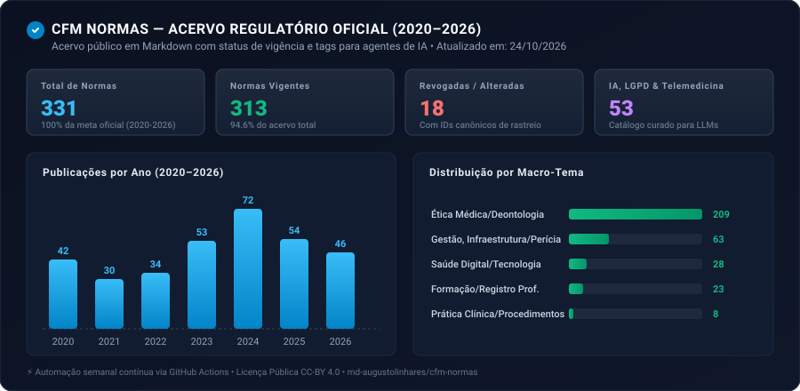

# CFM Normas (2020–2026)

> **Acervo aberto, versionado e estruturado das normativas oficiais do Conselho Federal de Medicina (CFM) em Markdown.**  
> Enriquecido com metadados relacionais, rastreamento de vigência no tempo e taxonomia temática nativa para agentes de Inteligência Artificial, sistemas de apoio à decisão clínica e profissionais de saúde.

<p align="left">
  <a href="https://github.com/md-augustolinhares/cfm-normas/actions"></a>
  <a href="PROGRESSO.md"></a>
  <a href="catalogo_ia_privacidade.json"></a>
  <a href="LICENSE"></a>
  <a href="https://md-augustolinhares.github.io/casos/cfm-normas/"></a>
</p>

---

## 📊 Painel de Dados do Acervo (Atualizado Automaticamente)

<p align="center">
  
</p>

> 💡 **Quer explorar o painel interativo com gráficos dinâmicos?** Abra o arquivo local [`estatisticas.html`](estatisticas.html) no seu navegador ou consulte a tabela analítica completa em **[`PROGRESSO.md`](PROGRESSO.md)**.

---

## 1. Manifesto e Propósito Clínico-Regulatório

### O Problema da Dispersão na Medicina
Historicamente, a classe médica enfrenta uma grande dispersão de fontes de informação. Resoluções éticas, pareceres sobre procedimentos inovadores, parâmetros de infraestrutura hospitalar e regras sobre telemedicina ficam distribuídos em portais governamentais lentos, visualizadores de PDF pouco acessíveis e publicações avulsas do Diário Oficial.

### O Risco da "Alucinação Regulatória" em IAs de Saúde
Com a crescente adoção de Modelos de Linguagem (LLMs) e agentes de IA para triagem, elaboração de prontuários e suporte à decisão médica, surge um perigo concreto: **a alucinação regulatória**.  
Quando uma IA consulta a web sem ancoragem estruturada, ela frequentemente cita resoluções **já revogadas ou alteradas** como se estivessem vigentes. Na medicina, orientar condutas ou elaborar documentos com base em normas revogadas expõe profissionais e instituições a infrações ético-disciplinares e riscos jurídicos graves.

### A Nossa Proposta
Pensando em compartilhar conhecimento e aproximar a comunidade médica, pesquisadores, desenvolvedores e juristas em torno de uma base sólida e acessível, este repositório disponibiliza as normativas mais recentes do CFM em formato de texto simples (**Markdown**) com **YAML Frontmatter padronizado**.  

O projeto funciona como uma **camada de ancoragem (grounding)** para garantir que médicos e inteligências artificiais consultem unicamente normas válidas, cientes do histórico de alterações.

---

## 2. Normas-Chave em Destaque (Saúde Digital, IA e Prática Clínica)

O acervo conta com um classificador léxico que analisa o teor de cada documento. Dentre as **53 normas** mapeadas na nossa trilha de tecnologia e ética moderna, destacam-se:

| Norma | Ano | Ementa Oficial / Tema Central | Status | Vínculo no Acervo |
| :--- | :---: | :--- | :---: | :---: |
| **Resolução CFM nº 2.454** | **2026** | **Marco Regulatório da Inteligência Artificial na Medicina.** Disciplina os limites, a supervisão humana obrigatória e a responsabilidade médica no uso de algoritmos clínicos. | `Vigente` | [`CFM-RES-2454-2026.md`](normas/resolucoes/2026/CFM-RES-2454-2026.md) |
| **Resolução CFM nº 2.314** | **2022** | **Regulamentação da Telemedicina no Brasil.** Define critérios para teleconsulta, teleinterconsulta, telediagnóstico, prontuário eletrônico e consentimento (TCLE). | `Vigente` | [`CFM-RES-2314-2022.md`](normas/resolucoes/2022/CFM-RES-2314-2022.md) |
| **Resolução CFM nº 2.311** | **2022** | **Regulamentação da Cirurgia Robótica.** Fixa regras para capacitação do cirurgião, habilitação e responsabilidade técnica em procedimentos assistidos por robôs. | `Vigente` | [`CFM-RES-2311-2022.md`](normas/resolucoes/2022/CFM-RES-2311-2022.md) |
| **Resolução CFM nº 2.417** | **2024** | **Processo Administrativo Eletrônico (PAe) e Fluxo Digital.** Normatiza a tramitação digital de consultas e pareceres nos Conselhos de Medicina. | `Vigente` | [`CFM-RES-2417-2024.md`](normas/resolucoes/2024/CFM-RES-2417-2024.md) |
| **Resolução CFM nº 2.418** | **2024** | **Emissão de Documentos Médicos Digitais.** Atualiza regras sobre receitas eletrônicas, atestados e certificação digital ICP-Brasil. | `Vigente` | [`CFM-RES-2418-2024.md`](normas/resolucoes/2024/CFM-RES-2418-2024.md) |
| **Resolução CFM nº 2.336** | **2023** | **Publicidade e Propaganda Médica.** Define os critérios éticos de comunicação, redes sociais, divulgação de títulos e imagens do paciente. | `Vigente` | [`CFM-RES-2336-2023.md`](normas/resolucoes/2023/CFM-RES-2336-2023.md) |
| **Resolução CFM nº 2.320** | **2022** | **Diretrizes Éticas de Reprodução Assistida.** Normatiza técnicas de fertilização, doação de gametas e preservação biológica. | `Vigente` | [`CFM-RES-2320-2022.md`](normas/resolucoes/2022/CFM-RES-2320-2022.md) |
| **Resolução CFM nº 2.271** | **2020** | **Normas de Funcionamento de UTIs e UCIs.** Fixa os requisitos de infraestrutura, equipamentos e responsabilidade técnica hospitalar. | `Vigente` | [`CFM-RES-2271-2020.md`](normas/resolucoes/2020/CFM-RES-2271-2020.md) |

Consulte o catálogo temático completo em **[`catalogo_ia_privacidade.json`](catalogo_ia_privacidade.json)**.

---

## 3. Passo a Passo: Como Utilizar este Repositório

### Para Profissionais de Saúde, Pesquisadores e Juristas
1. **Navegação Direta:** Todas as normas estão divididas por categoria e ano dentro da pasta [`normas/`](normas/):
   * `normas/resolucoes/` (atos coercitivos)
   * `normas/pareceres/` (respostas a consultas éticas)
   * `normas/recomendacoes/` (orientações do plenário)
2. **Checagem de Vigência:** Ao abrir qualquer arquivo `.md`, o cabeçalho no topo informa se a norma é `Vigente` ou `Revogada`. Se foi revogada, o campo `revoga_ids` aponta exatamente qual resolução posterior a substituiu.

---

### Para Agentes de IA e Desenvolvedores

#### Modo 1: Consulta Remota em Tempo $O(1)$ (Zero Infraestrutura)
Agentes de IA não precisam baixar o repositório nem manter banco vetorial. O arquivo [`catalogo.json`](catalogo.json) possui um **índice invertido de tags**:

```python
import requests

def consultar_normas_cfm_por_tag(tag: str) -> list[dict]:
    """Recupera metadados e links brutos de normas por tag em tempo O(1)."""
    catalogo_url = "https://raw.githubusercontent.com/md-augustolinhares/cfm-normas/main/catalogo.json"
    catalogo = requests.get(catalogo_url).json()
    
    # 1. Recupera lista de IDs no índice invertido
    ids_normas = catalogo.get("indices_tags", {}).get(tag, [])
    
    # 2. Retorna os documentos correspondentes
    return [d for d in catalogo["documentos"] if d["id"] in ids_normas]

# Exemplo de uso: buscar todas as normas de Inteligência Artificial
normas_ia = consultar_normas_cfm_por_tag("inteligencia-artificial")
for n in normas_ia:
    print(f"[{n['id']}] {n['ementa']}")
    # O agente pode ler o Markdown direto em: n['url_raw']
```

#### Modo 2: Integração em Pipelines de RAG (LangChain / LlamaIndex)
Cada arquivo Markdown preserva metadados estritos no Frontmatter que são herdados automaticamente como filtros relacionais:

```python
from langchain_community.document_loaders import DirectoryLoader, TextLoader

# Carrega todos os Markdowns mantendo metadados YAML (id, status, tags, ano)
loader = DirectoryLoader(
    "./normas",
    glob="**/*.md",
    loader_cls=TextLoader,
    loader_kwargs={"encoding": "utf-8"}
)
documentos = loader.load()
# Agora os chunks no seu banco vetorial (Qdrant/Pinecone) contêm filtros automáticos:
# metadata = {"status": "Vigente", "macro_tema": "Saúde Digital & Tecnologia", ...}
```

#### Modo 3: IDEs com IA (Cursor, Windsurf, Copilot)
Adicione a URL do repositório como contexto de documentação (`@docs`) na sua IDE para validar se prontuários eletrônicos, termos de consentimento e ferramentas de apoio clínico estão em conformidade com o CFM enquanto você programa.

---

## 4. Arquitetura de Engenharia e Automação

O pipeline foi projetado seguindo princípios de **Clean Code / Single Responsibility (SRP)** e opera com **custo zero** de infraestrutura:

```mermaid
flowchart TD
    subgraph Nuvem_GitHub_Actions [Automação Semanal na Nuvem (CRON: Todo Domingo 01:00 BRT)]
        A["1. Crawler CFM<br/>(Busca metadados JSON nativos)"] --> B["2. Stream em Memória<br/>(Baixa PDF em io.BytesIO)"]
        B --> C["3. Parser & Sanitizer<br/>(Converte para Markdown sem salvar PDF em disco)"]
        C --> D["4. Classificador Léxico<br/>(Carimba Macro-temas e Micro-tags)"]
        D --> E["5. Gravação Idempotente<br/>(Atualiza manifesto.json com SHA-256)"]
        E --> F["6. Gerador de Relatórios<br/>(catalogo.json, PROGRESSO.md, dashboard.svg)"]
        F --> G["7. Commit & Push Automático<br/>(github-actions[bot])"]
    end
```

* **Processamento Zero-Disco:** Nenhum arquivo PDF bruto é salvo em disco ou comitado. A conversão de PDF para Markdown ocorre diretamente na memória RAM (`io.BytesIO`), mantendo o acervo ultra-leve (**4,37 MB no total**).
* **Idempotência Rigorosa:** O arquivo `manifesto.json` registra o `sha256` de cada documento. O robô só processa normas novas ou que tenham sofrido alteração oficial.

---

## 5. Estrutura de Pastas do Repositório

```
cfm-normas/
├── .github/workflows/
│   └── atualizar-normas.yml          # Esteira semanal de automação via GitHub Actions
├── docs/assets/
│   └── dashboard.svg                 # Card visual de estatísticas renderizado no README
├── src/                              # Módulos Python com separação estrita de responsabilidades
│   ├── config.py                     # Constantes, endpoints e taxonomia temática
│   ├── crawler.py                    # Cliente HTTP com delay de cortesia e retries
│   ├── parser.py                     # Extração de texto de PDF e marcação de artigos
│   ├── sanitizer.py                  # Higienização contra injeções e limpeza de carimbos
│   ├── classifier.py                 # Motor de classificação em Macro-temas e Micro-tags
│   ├── exporter.py                   # Exportação em Markdown com YAML Frontmatter
│   ├── reports.py                    # Geração de catálogos e PROGRESSO.md
│   └── gerar_dashboard_svg.py        # Compilador do card vetorial de estatísticas
├── normas/
│   ├── resolucoes/                   # 196 resoluções (2020 a 2026)
│   ├── pareceres/                    # 134 pareceres (2020 a 2026)
│   └── recomendacoes/                # 1 recomendação oficial
├── catalogo.json                     # Catálogo global indexado em tempo O(1)
├── catalogo_ia_privacidade.json      # Catálogo filtrado para IA, Telemedicina e LGPD
├── manifesto.json                    # Registro de checkpoints e hashes de integridade
├── estatisticas.html                 # Dashboard interativo standalone com Chart.js
├── PROGRESSO.md                      # Painel oficial de acompanhamento de metas
├── COBERTURA.md                      # Metodologia e critérios de inclusão/exclusão
├── schemas/norma.schema.json         # JSON Schema oficial do Frontmatter
├── requirements.txt                  # Dependências Python mínimas
└── LICENSE                           # Licença aberta CC-BY 4.0
```

---

## 6. Declaração de Uso Público e Licença Aberta

Este repositório é um projeto de código aberto disponibilizado sob a licença **Creative Commons Attribution 4.0 International (CC-BY 4.0)**.

### O que isso significa na prática?
* ✅ **Uso Livre e Aberto:** Médicos, advogados, acadêmicos, startups de saúde, hospitais e desenvolvedores podem utilizar, consultar, indexar, modificar e redistribuir este acervo livremente.
* ✅ **Uso Comercial e em IA:** É expressamente permitido utilizar este acervo para alimentar bancos vetoriais (RAG), treinar e fazer fine-tuning de modelos de linguagem, ou embutir em produtos comerciais de prontuário e apoio clínico.
* 📌 **Atribuição:** A única exigência é conceder o devido crédito ao projeto **CFM Normas** e ao autor, referenciando o link oficial do repositório: `https://github.com/md-augustolinhares/cfm-normas`.

### Declaração de Limites
Este acervo constitui uma compilação e organização técnica de documentos públicos do Conselho Federal de Medicina. Ele **não substitui** o Diário Oficial da União nem constitui assessoria jurídica formal para casos individuais.

---

## 7. Sobre o Autor e Estudo de Caso

Desenvolvido por **Dr. Augusto Linhares**, médico (CRM-SP 280.787), pós-graduando em Inteligência Artificial e Ciência de Dados em Saúde pelo Instituto de Ensino e Pesquisa do Hospital Sírio-Libanês e fundador da EXC Medicina. Atua na intersecção entre medicina, engenharia de software e gestão de produtos clínicos (*Product Owner Healthcare*).

O estudo de caso completo, detalhando as decisões de arquitetura de dados, trade-offs e métricas de engenharia deste projeto, está publicado em:  
👉 **[Estudo de Caso Oficial — CFM Normas](https://md-augustolinhares.github.io/casos/cfm-normas/)**

---

## 8. Agradecimentos e Inspiração

Este projeto foi concebido a partir da inspiradora iniciativa do repositório [`ctresb/leis`](https://github.com/ctresb/leis), criado por [@ctresb](https://github.com/ctresb), adotando seus padrões abertos de transparência, catalogação em Markdown e organização de dados públicos para o Brasil.
